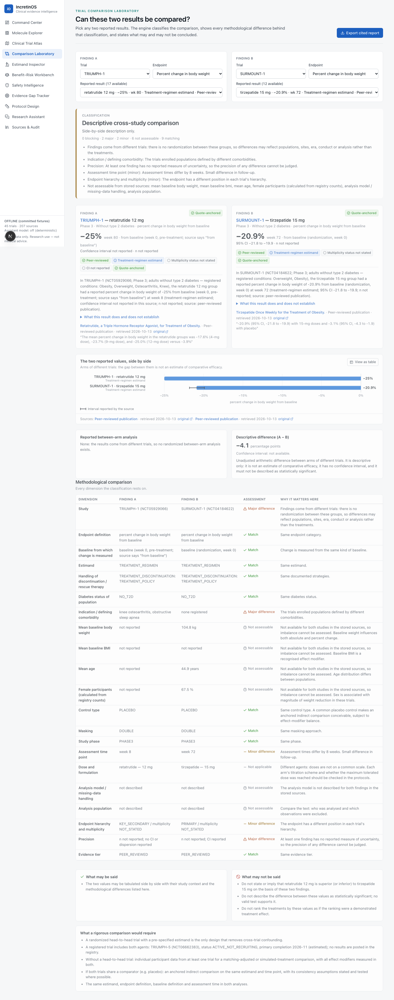

# IncretinOS

Clinical evidence and trial intelligence for incretin and amylin therapeutics, built entirely on public data.

IncretinOS helps clinical scientists and biostatisticians answer three questions about a body of trial evidence: **what do public sources actually report, can two results be compared, and what is still unknown?** The initial domain is Eli Lilly's obesity and diabetes portfolio — dulaglutide, tirzepatide, orforglipron (Foundayo), retatrutide, eloralintide, the eloralintide + tirzepatide combination, and adjacent pipeline compounds.

> Research software for qualified researchers. It is not a patient treatment tool, does not give medical advice or dosing recommendations, and is not a regulatory submission system. It is independent of Eli Lilly and uses no proprietary or patient-level data. No regulatory compliance (GxP, 21 CFR Part 11) is claimed.



## What it does

| Area | What you get |
|---|---|
| **Evidence ingestion** | Adapters for ClinicalTrials.gov API v2, PubMed E-utilities and openFDA (labels, FAERS) with retry/backoff, rate limiting, content hashing, versioned snapshots, change detection and a review queue. |
| **Normalized evidence model** | Drug → study → arm → endpoint → estimand → result → source. A value the source did not report is `NULL` and listed as missing — never zero. |
| **Comparability engine** | Classifies any two results as *direct randomized comparison*, *partially comparable*, *descriptive cross-study comparison*, *not suitable for efficacy comparison* or *insufficient evidence*, with a factor-by-factor explanation and the statements the evidence does and does not permit. |
| **Interpretation and validation** | Deterministic readings of each result and analysis, a language guard, and 15 scientific validation rules (non-inferiority is not superiority, estimands stay separate, missing intervals stay missing, …). |
| **Workbenches** | Benefit–risk profiles, preference-weighted summaries, hypothetical dose scenarios, safety intelligence, evidence-gap tracking, protocol-design calculations and reproducible synthetic simulations. |
| **Grounded assistant** | Answers composed from stored evidence with citations. Works with no language model; an optional model-drafted summary is kept only if every number traces to a cited evidence card. |
| **Provenance** | Every number carries its source, evidence tier, retrieval date, content hash, locator and verification status. Reports export as cited Markdown. |

## Quick start (offline, no API keys)

Requires Python ≥ 3.11 and Node ≥ 20.

```bash
cd backend && python3 -m venv .venv && .venv/bin/pip install -e ".[dev]"
```

```bash
cd backend && .venv/bin/incretinos seed --reset
```

```bash
cd backend && .venv/bin/incretinos serve --port 8000
```

In a second terminal:

```bash
cd frontend && npm install && INCRETINOS_API_URL=http://127.0.0.1:8000 npm run dev
```

Open <http://localhost:3000>. The seed step ingests 45 trials, their linked publications, four FDA labels and FAERS counts from committed fixtures in about 15 seconds; nothing touches the network.

### Docker

```bash
docker compose up --build
```

PostgreSQL, the API (migrates, then seeds from fixtures) and the web app start together; the app is at <http://localhost:3000>. Set `INCRETINOS_API_PORT` / `INCRETINOS_WEB_PORT` if 8000 or 3000 are taken.

## Working with live data

```bash
cd backend && .venv/bin/incretinos seed --live            # query the public APIs
```

```bash
cd backend && .venv/bin/incretinos check-updates --live   # re-fetch tracked records, report changes
```

```bash
cd backend && .venv/bin/incretinos seed --live --record   # refresh the committed fixtures
```

```bash
cd backend && .venv/bin/incretinos anchor-web             # re-verify curated press-release quotes
```

Other commands: `incretinos validate` (run the scientific rules), `incretinos report A B -o file.md` (export a comparison). Configuration is by environment variable — see [.env.example](.env.example). Setting `INCRETINOS_REVIEWER_TOKEN` enables review decisions; without it the API is read-only.

## Tests

```bash
cd backend && .venv/bin/pytest -q
```

```bash
cd frontend && npx playwright install chromium && npx playwright test
```

- **Backend: 159 tests**, all offline — ingestion and transport failure handling, identifier reconciliation, estimand classification, comparability, the twelve mandatory scientific cases (each with a negative test that corrupts the evidence and checks the rule fires), statistics validated against statsmodels/scipy and published worked values, safety guards, citation fidelity of the assistant, permissions and reports.
- **Frontend: 11 browser tests** covering the principal workflows, each failing on any browser-console error; they also capture the screenshots in [docs/screenshots](docs/screenshots) when run with `CAPTURE_DOC_SCREENSHOTS=1` (otherwise the captures go to the git-ignored `frontend/test-results/workflow-screenshots`).
- CI ([.github/workflows/ci.yml](.github/workflows/ci.yml)) runs lint, tests, the migration, a fresh seed, the validation rules and the browser tests.

## How evidence is kept honest

1. **Tiers are never blended.** FDA labeling, peer-reviewed publications, registry-posted results and press releases are separate rows with separate badges, even for the same arm and endpoint. Where they disagree, the discrepancy is itself surfaced.
2. **Verification is mechanical and visible.** *Machine-extracted* means parsed from a structured registry payload whose hash is stored. *Quote-anchored* means a curated value's locator quote was matched verbatim against the source text. Everything else is *pending human review* and sits in the review queue. Nothing is marked human-verified without a recorded decision.
3. **A number cannot be curated without its supporting text.** The curation schema rejects any value whose digits do not appear in its own locator quote.
4. **Text that may be copyrighted is not redistributed.** Registry records, FDA labels and FAERS counts are stored in full. For abstracts, press releases and review documents only a hash, the retrieval date and the short quotes that anchor curated values are kept.
5. **Calculations are deterministic and labelled.** Derived intervals, risk contrasts, utility scores, scenarios and simulations are produced outside any language model and are marked as inference, hypothetical or synthetic wherever they appear.

## Documentation

| Document | Contents |
|---|---|
| [docs/scientific-research.md](docs/scientific-research.md) | Drug-by-drug evidence with sources, retrieval dates and regulatory status (generated from the database) |
| [docs/product-requirements.md](docs/product-requirements.md) | Users, scope, requirements and acceptance criteria |
| [docs/data-source-inventory.md](docs/data-source-inventory.md) | Each source, what is taken from it, licence and storage policy |
| [docs/evidence-limitations.md](docs/evidence-limitations.md) | What the platform cannot tell you, and known weaknesses |
| [docs/architecture.md](docs/architecture.md) | System design, data model, engines, security, future restricted-data requirements |
| [docs/build-roadmap.md](docs/build-roadmap.md) | What is built, what was verified, and what remains |
| [docs/examples/acceptance-demonstrations.md](docs/examples/acceptance-demonstrations.md) | The seven acceptance demonstrations with real output |

## Repository layout

```
backend/
  incretinos/
    ingestion/     transports, snapshots, ClinicalTrials.gov / PubMed / openFDA adapters, pipeline, scheduler
    curation/      schema, loader and data files for publication-, label- and release-reported evidence
    engines/       estimands, findings, comparability, interpretation, validation, stats, safety,
                   benefit_risk, gaps, design
    assistant/     retrieval, deterministic answers, optional model provider, citation check
    reports/       cited Markdown export
    api/           FastAPI application
  fixtures/        recorded public-API responses for offline use
  tests/           unit and integration tests
  scripts/         research-notes converter, document generator
frontend/          Next.js application and Playwright tests
research/          retrieval notes (with source URLs and locator quotes) and conversion report
docs/              specification, limitations, examples, screenshots
```

## Ownership and permissions

Maintained by **Jorge Rodriguez** ([@jorgeAIStatistics](https://github.com/jorgeAIStatistics)).
See [COPYRIGHT.md](COPYRIGHT.md) for ownership and third-party attribution scope,
and [LICENSE](LICENSE) for permissions. Source-visible for portfolio review; reuse rights are reserved.
